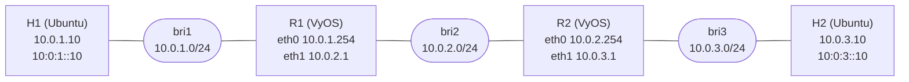

# Computer Networks

Hands-on networking work in one place: a virtual routing lab built from Linux VMs and VyOS routers, and a
socket-based group messaging system in C++. The larger load-balancing project lives in its own repository.

[](LICENSE)

| Part | What it is | Highlights |
|---|---|---|
| [`routing-lab/`](routing-lab) | Two Ubuntu hosts and two VyOS routers on Linux bridges under QEMU/KVM, with static routing for IPv4 and IPv6 | 3-hop path, dual-stack ping and traceroute, iperf throughput, router and host configs |
| [`messaging-system/`](messaging-system) | Group messaging with a TCP control channel, UDP multicast data path, IPv4 and IPv6, hostname resolution and TLS | Select-based I/O multiplexing, per-group multicast addresses, timestamps and timing on the echo service |
| [LoadBalancerLab](https://github.com/Rmuk655/network-load-balancer-lab) | Discrete-event load-balancer simulator with a real-process deployment path and a Prequal paper reproduction | Separate repository |

## Routing lab at a glance



H1 reaches H2 across both routers in three hops over IPv4 and IPv6, with about 11.7 ms average round trip
and 4.3 Gbit/s TCP throughput measured by iperf. Details and screenshots are in
[`routing-lab/`](routing-lab).

## Messaging system at a glance

A server and several clients communicate over two planes: TCP carries group management (create, join, leave),
and UDP multicast carries the group messages. A separate TCP echo service supports plain and TLS
connections and reports receive and send timestamps and timings. See
[`messaging-system/README.md`](messaging-system/README.md) for architecture, commands and build steps.

```bash
cd messaging-system
g++ -std=c++17 -Wall -Wextra -O2 server.cpp -o server -lssl -lcrypto -pthread
g++ -std=c++17 -Wall -Wextra -O2 client.cpp -o client -lssl -lcrypto -pthread
```

## License

MIT, see [LICENSE](LICENSE).
