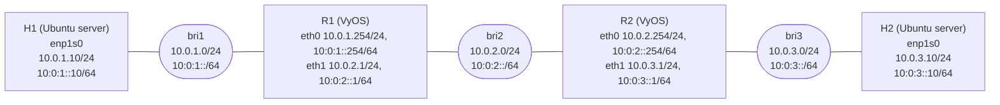

# Routing lab: Linux bridges and VyOS static routing

A small virtual network built in three steps: two Linux servers talking over a bridge, then two VyOS routers
connecting three subnets, with static routes for both IPv4 and IPv6. Everything ran as QEMU/KVM virtual
machines managed with `virt-manager` on an Ubuntu desktop.

## Topology



| Subnet | IPv4 | IPv6 | Bridge |
|---|---|---|---|
| H1 – R1 | 10.0.1.0/24 | 10:0:1::/64 | `bri1` |
| R1 – R2 | 10.0.2.0/24 | 10:0:2::/64 | `bri2` |
| R2 – H2 | 10.0.3.0/24 | 10:0:3::/64 | `bri3` |

## What each step did

### Step 1: two Linux server VMs

Two Ubuntu Server VMs (`server1`, `server2`) installed with `virt-manager`, with a hostname and a working
`ip addr` on each.

### Step 2: static addressing on a Linux bridge

`server1` was given `10.0.0.1/24` and `server2` `10.0.0.253/24` through netplan, then checked with ping and
iperf.

| Check | Result |
|---|---|
| `ping` server1 to server2 | 4/4 replies, 0% loss, average 2.37 ms |
| `iperf` TCP, 10 s | 14.5 GBytes, **12.4 Gbit/s** (client and server report the same figure) |

The throughput is high because both VMs sit on the same host bridge and nothing leaves memory.

### Step 3: two VyOS routers and static routes

Hosts use the nearer router as their default gateway; each router has one static route to the subnet behind
the other router.

```yaml
# H1: /etc/netplan/50-cloud-init.yaml (H2 is the mirror image with 10.0.3.10 and gateway 10.0.3.1)
network:
  version: 2
  ethernets:
    enp1s0:
      addresses:
        - 10.0.1.10/24
        - 10:0:1::10/64
      routes:
        - to: default
          via: 10.0.1.254
        - to: default
          via: 10:0:1::254
```

```text
# R1 (VyOS)
set interfaces ethernet eth0 address 10.0.1.254/24
set interfaces ethernet eth0 address 10:0:1::254/64
set interfaces ethernet eth1 address 10.0.2.1/24
set interfaces ethernet eth1 address 10:0:2::1/64
set protocols static route 10.0.3.0/24 next-hop 10.0.2.254
set protocols static route6 10:0:3::/64 next-hop 10:0:2::254
commit
save
```

R2 mirrors R1: `eth0` is `10.0.2.254/24` and `10:0:2::254/64`, `eth1` is `10.0.3.1/24` and `10:0:3::1/64`, and
its static route sends `10.0.1.0/24` via `10.0.2.1`.

### Results

| Check | Result |
|---|---|
| H1 pings R1 (`10.0.1.254`) | 0% loss, average 2.8 ms |
| H1 pings R2 (`10.0.2.254`) | 0% loss, average 7.2 ms |
| H1 pings H2 (`10.0.3.10`) | 0% loss, average 11.7 ms |
| `traceroute 10.0.3.10` | 3 hops: R1, R2, H2 |
| `traceroute6 10:0:3::10` | 3 hops: R1, R2, H2 |
| `iperf` H1 to H2 across both routers | 5.03 GBytes in 10 s, **4.3 Gbit/s** |

Compared with step 2, throughput drops from 12.4 to 4.3 Gbit/s once traffic has to be forwarded by two
software routers, and the round-trip time grows by about 4 to 5 ms per router hop.

## Screenshots

### Module 1: VM hosts
- [`M1_01_server1_hostnamectl_ip_addr.png`](screenshots/module-1-vm-hosts/M1_01_server1_hostnamectl_ip_addr.png)

### Module 2: Linux bridge and static addressing
- [`M2_01_server1_netplan_10.0.0.1.png`](screenshots/module-2-linux-bridge/M2_01_server1_netplan_10.0.0.1.png)
- [`M2_02_server2_netplan_10.0.0.253.png`](screenshots/module-2-linux-bridge/M2_02_server2_netplan_10.0.0.253.png)
- [`M2_03_server1_ping_server2.png`](screenshots/module-2-linux-bridge/M2_03_server1_ping_server2.png)
- [`M2_04_iperf_server1_server2.png`](screenshots/module-2-linux-bridge/M2_04_iperf_server1_server2.png)

### Module 3: VyOS and static routing
| | |
|---|---|
| Router interfaces | [R1](screenshots/module-3-vyos-static-routing/M3_01_R1_show_interfaces_MACs.png), [R2](screenshots/module-3-vyos-static-routing/M3_02_R2_show_interfaces_MACs.png) |
| Router configuration | [R1 config and commit](screenshots/module-3-vyos-static-routing/M3_03_R1_config_commit.png) |
| Routing tables | [R2 ping and IPv4 routes](screenshots/module-3-vyos-static-routing/M3_04_R2_ping_R1_and_show_ip_route.png), [R1 IPv4](screenshots/module-3-vyos-static-routing/M3_09_R1_show_ip_route.png), [R1 IPv6](screenshots/module-3-vyos-static-routing/M3_10_R1_show_ipv6_route.png), [R2 IPv6](screenshots/module-3-vyos-static-routing/M3_11_R2_show_ipv6_route.png) |
| Hosts | [H1 netplan and routes](screenshots/module-3-vyos-static-routing/M3_05_H1_netplan_and_routes.png), [H1 pings routers](screenshots/module-3-vyos-static-routing/M3_06_H1_ping_R1_R2.png), [H2 netplan and routes](screenshots/module-3-vyos-static-routing/M3_07_H2_netplan_and_routes.png) |
| End to end | [ping and traceroute v4 and v6](screenshots/module-3-vyos-static-routing/M3_08_H1_to_H2_ping_traceroute_v4_v6.png), [ping6](screenshots/module-3-vyos-static-routing/M3_12_H1_to_H2_ping6.png), [iperf](screenshots/module-3-vyos-static-routing/M3_13_iperf_H1_to_H2_via_routers.png) |

## Reproducing it

1. Ubuntu desktop with `virt-manager`, `bridge-utils`, `iperf` and `traceroute` installed.
2. Two Ubuntu Server VMs and two VyOS VMs.
3. Three Linux bridges (`bri1`, `bri2`, `bri3`); attach each VM NIC to the bridge in the topology above.
4. Apply the netplan files on the hosts and the VyOS commands on the routers.
5. Verify with `ping`, `traceroute`, `traceroute6` and `iperf`.
